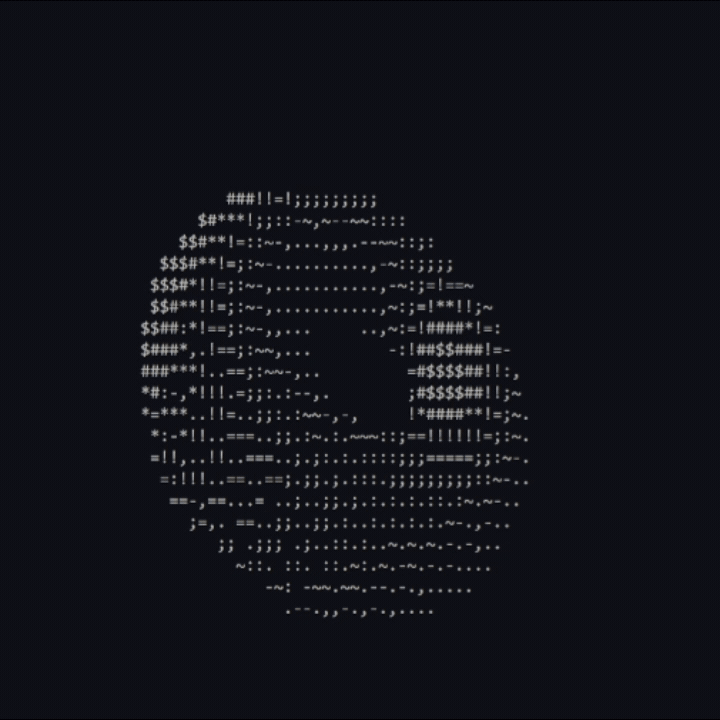

# Spinning Donut and Trident

A small C project that renders two animated ASCII-style terminal graphics in real time: a rotating 3D donut and a spinning trident. Both are built with pure C, math-based projection, lighting, and ANSI terminal control.

<p align="center">
  
</p>

<p align="center">
  
</p>

## Features

- Real-time 3D ASCII rendering in the terminal
- Perspective projection and depth buffering
- Simple lighting/shading for surface brightness
- Smooth rotation animation without external libraries
- Two standalone demos: a classic donut and a 3D trident

## Project files

- `donut.c` — classic rotating donut animation
- `trident.c` — spinning trident animation
- `donut.exe` / `trident.exe` — prebuilt Windows binaries
- `spinning_donut.gif` / `spinning_trident.gif` — recorded GIF demos

## Requirements

- A C compiler such as GCC, MinGW-w64, or MSYS2 on Windows
- `math.h` support (`-lm` linker flag on GCC/MinGW)
- A terminal that supports ANSI escape sequences

## Build instructions

From the project directory, compile the programs with:

```bash
gcc donut.c -lm -o donut.exe
gcc trident.c -lm -o trident.exe
```

If you are using MinGW, the same commands usually work directly from the terminal.

## Run the demos

```bash
./donut.exe
./trident.exe
```

On Windows, you can also run the generated `.exe` files directly from Command Prompt or PowerShell.

## Notes

These animations are intentionally lightweight and terminal-based. They use ASCII characters and runtime rendering rather than a graphical engine, which makes them easy to build and run on nearly any terminal.

## License

This project is provided as-is for educational and entertainment purposes.
